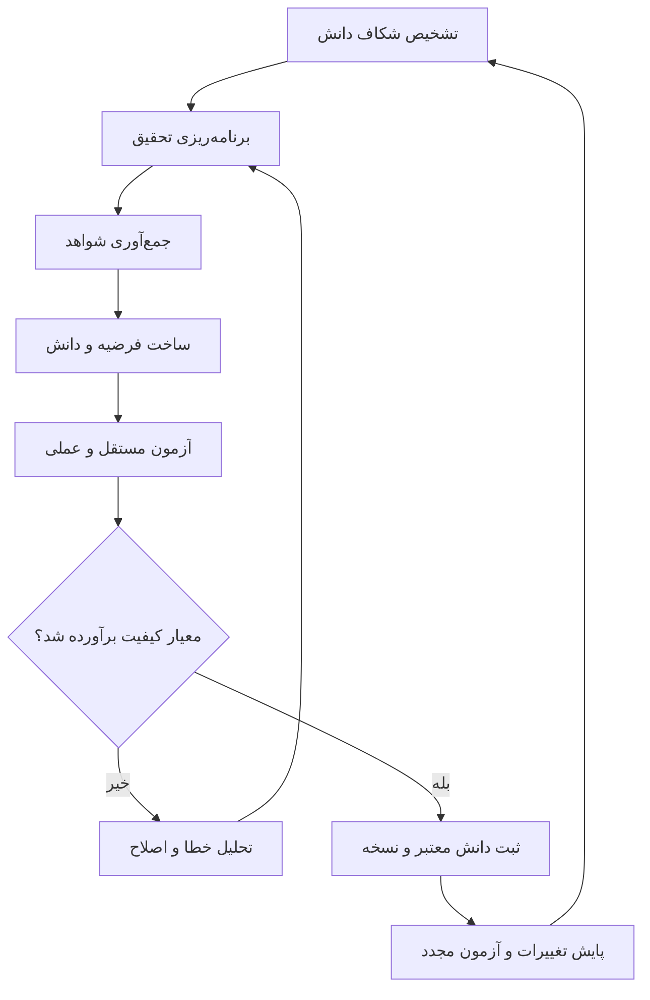

# بخش یادگیری دستیار شخصی — نقشه راه و فهرست نهایی قابلیت‌ها

> این سند مبنای طراحی و پیاده‌سازی زیرسیستم یادگیری در پروژه Personal-AI-assistant است. ابتدا نقشه پیشنهادی شروع پروژه آمده و سپس فهرست قابلیت‌های سند «فهرست نهایی بخش یادگیری My-AI» گردآوری شده است. موارد مربوط به My-ai توصیف بررسی قبلی‌اند؛ موارد پیشنهادی الزاماً به معنی نقص قطعی در پروژه جدید یا قدیم نیستند. هر قابلیت باید پیش از پیاده‌سازی با کد، نیاز واقعی و آزمون پذیرش سنجیده شود.

## ۱. نقشه پیشنهادی شروع پروژه

### اصل راهنما
یادگیری صرفاً ذخیره‌کردن متن نیست. سیستم باید بتواند کمبود دانش را تشخیص دهد، شواهد جمع‌آوری کند، دانش را ارزیابی کند و با آزمون مستقل نشان دهد که عملکرد بهتر شده است. تغییر دانش یا رفتار نباید بدون ارزیابی، نسخه‌بندی و امکان بازگشت، خودکار مورد اعتماد قرار بگیرد.

### ترتیب شروع
1. **بررسی My-ai و ثبت درس‌آموخته‌ها:** مسیرهای واقعی کد، خطاها، محدودیت‌ها، بدهی فنی و علت/اثر هر مشکل را مستند کنید. قابلیت‌هایی را که صرفاً در بررسی قبلی پیدا نشده‌اند، بدون بررسی کامل «غایب قطعی» اعلام نکنید.
2. **تعریف قرارداد هسته یادگیری:** ورودی‌ها، خروجی‌ها، وضعیت‌ها، خطاها، ساختار داده، معیار موفقیت، محدودیت منابع و رفتار توقف/ادامه را مشخص کنید.
3. **ساخت هسته حداقلی:** یک موضوع را از منابع مشخص یاد بگیرد، شواهد و منشأ را ذخیره کند، آزمون مستقلی اجرا کند و گزارش نتیجه بدهد.
4. **تثبیت و آزمون:** توقف و ادامه، اجرای مجدد، خطای منبع، تناقض اطلاعات، قطع سرویس، محدودیت منابع و بازیابی را آزمایش کنید.
5. **گسترش مرحله‌ای:** پس از موفقیت هسته، برنامه‌ریزی خودکار تحقیق، تشخیص شکاف دانش، یادگیری تطبیقی، حافظه پیشرفته، رابط گرافیکی و اتصال به قابلیت‌های دیگر دستیار را اضافه کنید.

### سه سند طراحی پیشنهادی
- `LESSONS_LEARNED.md` — مشکلات، محدودیت‌ها و درس‌های آموخته‌شده از My-ai؛ همراه با علت، اثر و راه پیشگیری.
- `LEARNING_ARCHITECTURE.md` — هسته یادگیری، چرخه عمر دانش، منابع، شواهد، اعتبارسنجی، حافظه و ارزیابی.
- `IMPLEMENTATION_ROADMAP.md` — مراحل پیاده‌سازی، معیار پذیرش و آزمون‌های هر مرحله.

### ترتیب فنی هسته
**قرارداد داده و صحت → آزمون و مشاهده‌پذیری → امنیت و ایزوله‌سازی → بازیابی و پایداری → قابلیت‌های یادگیری پیشرفته.**

Fine-tuning یا آموزش مجدد وزن‌های مدل را فقط وقتی بررسی کنید که داده باکیفیت، آزمون معتبر و معیار روشن بهبود وجود داشته باشد. ذخیره تجربه، ذخیره دانش در حافظه و آموزش مجدد مدل سه مفهوم جداگانه‌اند.

---

## ۲. قابلیت‌های اصلی یادگیری

موارد زیر در سند قبلی به‌عنوان قابلیت‌های موجود یا مستندشده در My-ai معرفی شده بودند؛ وجود در کد به‌تنهایی تضمین نمی‌کند که قابلیت در همه پیکربندی‌ها فعال باشد یا در محیط اجرا درست عمل کند.

1. **ساخت برنامه آموزشی (Curriculum Generation):** تعریف حوزه یادگیری و تولید سرفصل‌های متناسب؛ در نبود مدل زبانی، استفاده از سرفصل جایگزین برای موضوع ناشناخته. مرجع قبلی: `my_ai/dynamic_learning.py`.
2. **شناسایی پیش‌نیازها (Prerequisite Discovery):** بررسی پیش‌نیازهای مرتبط پیش از آموزش؛ در مستندات قبلی حداکثر سه موضوع قبلی بررسی می‌شد. مرجع: `my_ai/learner.py`.
3. **گردآوری منابع آموزشی (Source Discovery):** استفاده از مستندات رسمی و منابع مرتبط/تکمیلی و ارتباط منابع با زبان، موضوع و نسخه فناوری. مراجع: `my_ai/learning_sources.py` و `my_ai/topic_resources.py`.
4. **یادگیری از وب (Web Learning):** جست‌وجو در وب، دریافت صفحات در دسترس، استخراج درس با اتکا به شواهد و ثبت منابع استفاده‌شده؛ امکان افزودن موضوع به برنامه آموزشی. مرجع: `my_ai/web_learning.py`.
5. **تولید درس و ثبت محتوا (Lesson Generation):** تولید و ذخیره محتوای درس به‌گونه‌ای که بعداً از رابط کاربری قابل مشاهده باشد. مرجع اصلی: `my_ai/learner.py`.
6. **ارزیابی یادگیری (Assessment):** ثبت امتیاز ارزیابی، وضعیت تکمیل و پیشرفت موضوع. وجود مرحله ارزیابی به‌تنهایی صحت علمی مطالب را تضمین نمی‌کند. مراجع: متدهای `assess` و `record_experience` در `my_ai/learner.py`.
7. **ذخیره دانش پایدار (Persistent Knowledge):** ذخیره دانش استخراج‌شده در حافظه محلی برای بازیابی‌های آینده، جدا از متن صرف مکالمه. مرجع: `my_ai/memory.py`.

## ۳. امکانات تکمیلی و مدیریت فرایند یادگیری

8. **توسعه تدریجی سرفصل‌ها:** تولید سرفصل تکمیلی برای حوزه‌های جدید و ادغام با سرفصل‌های موجود، با جلوگیری از حذف موضوعات قبلی و افزودن موارد تکراری.
9. **بازبینی دوره‌ای دانش (Periodic Review):** ثبت زمان آخرین و بازبینی بعدی؛ در سند قبلی فاصله پیش‌فرض هفت روز در `dynamic_learning.py` ذکر شده بود. بازبینی منابع و سرفصل‌ها و افزودن موارد جدید به دانش قبلی.
10. **تشخیص تغییر منابع و نسخه‌ها:** نگهداری هش محتوا و شماره نسخه؛ قرار دادن کار بازآموزی در صف پس از تغییر منبع؛ ثبت نسخه موضوع و سازگاری با نسخه فناوری.
11. **حافظه تجربه‌های شخصی (Personal Learning Experiences):** ذخیره تجربه موفق/ناموفق، زمینه اجرا، نتیجه و روش بازیابی؛ اتصال تجربه به موضوع و نسخه و امکان مشاهده سابقه.
12. **تلاش مجدد (Retry):** تلاش مجدد محدود با فاصله زمانی افزایشی؛ جلوگیری از تکرار نامحدود خطاهای دائمی HTTP مانند 401 و 404.
13. **توقف و ادامه یادگیری:** توقف اجرا و ذخیره وضعیت؛ بازیابی نشست فعال یا متوقف‌شده بدون شروع دوباره از ابتدا.
14. **نمایش پیشرفت و وضعیت:** نمایش درصد پیشرفت دوره و موضوع، تعداد موضوع‌های تکمیل‌شده و باقی‌مانده، وضعیت اجرا، امتیاز ارزیابی و متن درس.
15. **بازیابی منابع خراب و پشتیبانی از VPN:** ثبت نشانی‌های ناموفق و علت خطا، جست‌وجوی منبع جایگزین، بررسی مجدد نشانی اصلی با گزینه VPN و تفکیک خطای شبکه از خطای مدل.
16. **تنظیم ذخیره تجربه شخصی:** فعال یا غیرفعال‌کردن ذخیره و استفاده از تجربه‌های آموزشی شخصی؛ در My-ai گزینه `learning.personal_experience` ذکر شده بود.

## ۴. مدیریت منابع آموزشی

| قابلیت | توضیح |
|---|---|
| دسته‌بندی منبع | ثبت نوع منبع مانند مستندات رسمی، استاندارد، GitHub، کتاب یا فایل |
| اولویت‌بندی | تعیین اولویت و وزن منابع |
| ثبت نسخه | نگهداری نسخه منبع و اطلاعات سازگاری |
| ثبت منشأ | ذخیره اطلاعات منشأ منبع |
| تأیید یا رد منبع | وضعیت تأییدشده، ردشده، در انتظار بررسی یا منسوخ |
| تشخیص تغییر محتوا | مقایسه هش محتوا و تشخیص تغییر |
| صف بازآموزی | ثبت و پیگیری کارهای بازآموزی ناشی از تغییر منبع |

مرجع قبلی: `my_ai/learning_catalog.py`.

## ۵. جریان کامل اجرای یادگیری

1. انتخاب موضوع یا حوزه، مانند Python یا فناوری جدید.
2. ساخت یا بازیابی برنامه آموزشی شامل سرفصل‌ها، نسخه‌ها و پیش‌نیازها.
3. دریافت و بررسی منابع رسمی و تکمیلی؛ جست‌وجوی جایگزین در صورت نیاز.
4. استخراج دانش و تولید درس.
5. ذخیره دانش و تجربه.
6. ارزیابی و بررسی سازگاری نسخه.
7. ثبت پیشرفت و بازبینی دوره‌ای.
8. ادامه آموزش، بررسی تغییر منابع و بازآموزی در صورت نیاز.

مستند مرجع در پروژه قبلی: `LEARNING_END_TO_END_FLOW.md`.

## ۶. فایل‌های مرتبط در My-ai

| فایل | مسئولیت گزارش‌شده |
|---|---|
| `learner.py` | موتور یادگیری، پیش‌نیازها، منابع، ارزیابی و تجربه‌ها |
| `dynamic_learning.py` | ساخت و ادغام سرفصل‌ها و بازبینی دوره‌ای |
| `curriculum.py` | برنامه‌های آموزشی، منابع و نسخه‌ها |
| `web_learning.py` | یادگیری از وب و افزودن دانش به برنامه |
| `learning_sources.py` | منابع مختص هر مبحث و ثبت تاریخچه منابع |
| `learning_catalog.py` | کاتالوگ منابع و صف بازآموزی |
| `learning.py` | رابط کاربری صفحه یادگیری |
| `learning-page.js` | نمایش پیشرفت، کنترل آموزش و تجربه‌های ذخیره‌شده |

## ۷. قابلیت‌هایی که باید بررسی یا توسعه داده شوند

این موارد در سند قبلی قابلیت‌های مفید در سیستم‌های پیشرفته‌تر معرفی شده‌اند. «تأیید نشدن در بررسی قبلی» به معنی اثبات نبودن قطعی در My-ai نیست.

| اولویت | قابلیت | هدف | وضعیت گزارش‌شده در بررسی قبلی |
|---:|---|---|---|
| ۱ | یادگیری از بازخورد کاربر | تأیید/رد پاسخ و استفاده از بازخورد برای اصلاح پاسخ‌های آینده | ثبت تجربه وجود داشت؛ حلقه کامل بازخورد تأیید نشده بود |
| ۲ | بهبود واقعی مدل | آموزش تکمیلی یا تنظیم دقیق با داده معتبر، نه صرفاً ذخیره اطلاعات | در بررسی قبلی تأیید نشده بود |
| ۳ | حافظه شخصی‌سازی‌شده | یادگیری ترجیحات، اهداف، سطح دانش و شیوه پاسخ‌گویی کاربر | حافظه و تجربه وجود داشت؛ شخصی‌سازی کامل تأیید نشده بود |
| ۴ | بازیابی معنایی دانش (RAG) | بازیابی بخش‌های مرتبط بر اساس معنا، نه فقط واژه‌ها | معماری کامل تأیید نشده بود |
| ۵ | ارزیابی مستقل کیفیت پاسخ | سنجش دقت، صحت، ارتباط، کامل‌بودن و اطمینان | ارزیابی آموزشی مطرح بود؛ پوشش جامع تأیید نشده بود |
| ۶ | تشخیص اطلاعات متناقض | مقایسه منابع و ارزیابی پشتوانه ادعاهای متعارض | مدیریت منابع وجود داشت؛ حل نظام‌مند تناقض‌ها تأیید نشده بود |
| ۷ | یادگیری چندوجهی | یادگیری از متن، تصویر، صوت، ویدئو، نمودار و داده ساختاریافته | در بررسی قبلی تأیید نشده بود |
| ۸ | تمرین عملی امن | اجرای کد، آزمایش فرضیه، شبیه‌سازی و سنجش نتیجه | در بررسی قبلی تأیید نشده بود |
| ۹ | یادگیری تطبیقی | تنظیم دشواری و مسیر بر اساس نقاط قوت، ضعف و آزمون‌ها | برنامه و پیش‌نیاز وجود داشت؛ تطبیق کامل تأیید نشده بود |
| ۱۰ | مرور فاصله‌دار | مرور در زمان مناسب، به‌ویژه برای موضوعات ضعیف | مرور دوره‌ای مطرح بود؛ زمان‌بندی شخصی‌سازی‌شده تأیید نشده بود |
| ۱۱ | بازبینی چندمرحله‌ای پاسخ | تولید، نقد مستقل و اصلاح پاسخ | در بررسی قبلی تأیید نشده بود |
| ۱۲ | آزمون خودکار پس از تغییر | اجرای دوباره آزمون‌ها پس از تغییر دانش یا منبع و کشف افت کیفیت | ردیابی تغییر منبع مطرح بود؛ آزمون رگرسیون تأیید نشده بود |
| ۱۳ | مدیریت فراموشی و منسوخ‌شدن دانش | شناسایی و اصلاح/حذف کنترل‌شده اطلاعات قدیمی، تکراری یا نادرست | وضعیت منابع مطرح بود؛ سیاست جامع دانش تأیید نشده بود |
| ۱۴ | منشأ هر پاسخ | ردیابی ادعا به منبع، نسخه و بخش دانش | منشأ منبع مطرح بود؛ ردیابی تک‌تک ادعاها تأیید نشده بود |
| ۱۵ | حریم خصوصی داده‌های یادگیری | کنترل ذخیره‌سازی، حذف و مجازبودن استفاده از داده برای آموزش | تنظیم تجربه شخصی وجود داشت؛ کنترل کامل حریم خصوصی تأیید نشده بود |

## ۸. قابلیت‌های یادگیری پیشرفته پیشنهادی

### ۸.۱. موتور تشخیص شکاف دانش (Knowledge Gap Detector)
به‌طور پیوسته مشخص کند:
- چه موضوعاتی هنوز یاد گرفته نشده‌اند؟
- کدام مفاهیم فقط سطحی درک شده‌اند؟
- کجا منبع معتبر یا شواهد کافی وجود ندارد؟
- کدام خطاها تکرار می‌شوند؟

هدف: پیدا کردن اولویت‌های یادگیری بدون انتظار برای دستور صریح.

### ۸.۲. برنامه‌ریز خودکار تحقیق (Autonomous Research Planner)
موضوع را به پرسش‌های کوچک‌تر تقسیم کند، ترتیب تحقیق را مشخص کند، منابع را جمع‌آوری کند و گزارش مستند بسازد. برای نمونه، در امنیت وب از HTTP و احراز هویت به آسیب‌پذیری‌ها، روش‌های آزمایش و تمرین عملی برسد.

### ۸.۳. آزمایشگاه اثبات یادگیری (Learning Verification Lab)
یک درس فقط زمانی آموخته‌شده اعلام شود که سیستم در آزمونی مستقل از متن درس موفق شود؛ مانند حل مسئله جدید، اجرای کد یا مقایسه پیش‌بینی با نتیجه واقعی. تولید متن درس به‌تنهایی اثبات یادگیری نیست.

### ۸.۴. گراف دانش و روابط علّی (Knowledge & Causal Graph)
مفاهیم، شواهد، پیش‌نیازها، تناقض‌ها و روابط علت‌ومعلولی را به هم متصل کند؛ از جمله شرایطی که یک رابطه معتبر است یا اعتبارش را از دست می‌دهد.

### ۸.۵. موتور فرضیه‌سازی و رد فرضیه (Hypothesis Engine)
چند توضیح احتمالی بسازد، شواهد موافق و مخالف هرکدام را گردآوری کند و آزمایش‌هایی برای تأیید یا رد آن‌ها طراحی کند؛ به‌جای پذیرفتن نخستین پاسخ محتمل.

### ۸.۶. تاریخچه تکامل دانش (Knowledge Evolution Timeline)
برای هر مفهوم ثبت کند:
- چه زمانی برای نخستین بار یاد گرفته شد؟
- بر اساس چه شواهدی پذیرفته شد؟
- چه زمانی و چرا تغییر کرد؟
- چرا نسخه قبلی رد شد؟
- کدام پاسخ‌ها تحت تأثیر تغییر قرار می‌گیرند؟

امکان بازگشت به نسخه قبلی و بررسی علت خطا نیز فراهم شود.

### ۸.۷. تیم عامل‌های تخصصی (Specialist Agent Team)
- پژوهشگر: جمع‌آوری منابع
- معلم: توضیح مفاهیم
- منتقد: پیدا کردن خطا و تناقض
- آزمایشگر: بررسی عملی ادعاها
- ارزیاب: سنجش کیفیت نتیجه
- هماهنگ‌کننده: جمع‌بندی خروجی‌ها

تعدد عامل‌ها به‌تنهایی تضمین کیفیت نیست؛ برای هر نقش باید معیار ارزیابی روشن وجود داشته باشد.

### ۸.۸. محیط تمرین ایزوله (Sandbox Lab)
اجرای کد و آزمایش‌های مجاز در محیط محدود، سنجش خروجی، ثبت خطا و اجرای دوباره راه‌حل اصلاح‌شده، بدون دسترسی آزاد به سیستم اصلی.

### ۸.۹. نقشه توانایی واقعی (Capability Map)
توانایی هر مهارت را با آزمون واقعی اندازه بگیرد:
- دانستن مفاهیم
- حل مسئله جدید
- اجرای موفق
- تشخیص خطا
- انتقال آموخته‌ها به مسئله‌ای متفاوت

امتیاز مهارت باید بر شواهد تکیه کند، نه تعداد درس‌های خوانده‌شده.

### ۸.۱۰. مدیر هزینه و ارزش یادگیری (Learning ROI Manager)
زمان، پردازش، هزینه و سود احتمالی هر فعالیت را تخمین بزند و فعالیت‌هایی را انتخاب کند که با کمترین هزینه بیشترین بهبود را دارند. اگر اصلاح منبع یا بازیابی کافی است، بی‌دلیل مدل را دوباره آموزش ندهد.

## ۹. اولویت پیشنهادی قابلیت‌های پیشرفته

1. **اولویت بسیار بالا — تشخیص شکاف دانش و آزمون مستقل:** سیستم کمبود دانش را تشخیص دهد و آزمون قابل‌تکرار برای اثبات یادگیری داشته باشد.
2. **اولویت بسیار بالا — گراف دانش و تاریخچه شواهد:** هر ادعا، منبع، نسخه، آزمون و تغییر دانش قابل ردیابی باشد.
3. **اولویت بالا — برنامه‌ریز تحقیق و آزمایشگاه امن:** تحقیق به وظایف مشخص تبدیل شود و نتایج عملاً آزمایش شوند.
4. **مرحله بعد — عامل‌های تخصصی و بهینه‌سازی خودکار:** پس از ایجاد معیارهای ارزیابی، نقش‌های تخصصی افزوده شوند تا کیفیت هر مرحله جداگانه سنجیده شود.

اگر فقط سه قابلیت قابل توسعه باشند، پیشنهاد قبلی این سه مورد است: **تشخیص شکاف دانش، آزمایشگاه اثبات یادگیری، و گراف دانش با ردیابی شواهد.**

## ۱۰. قابلیت‌های انتقالی و تکمیلی یادگیری

- **یادگیری انتقالی بین حوزه‌ها:** استفاده از آموخته‌های یک حوزه برای حل مسئله حوزه‌ای دیگر، همراه با اعتبارسنجی.
- **تشخیص تغییر شرایط جهان:** تشخیص دانش وابسته به زمان، زمان بررسی مجدد و اطلاعاتی که دیگر قابل اتکا نیست.
- **بهبود خودکار گردش‌کار یادگیری:** یادگیری از نتایج گذشته برای انتخاب روش تحقیق، منابع و آزمون مؤثرتر؛ همراه با ثبت تغییرات و امکان بازگشت.

## ۱۱. چرخه معماری پیشنهادی یادگیری

این چرخه باید با محدودیت هزینه، کنترل دسترسی، ثبت رویدادها و تأیید انسانی برای اقدامات حساس اجرا شود.

---

## ۱۲. مهندسی نرم‌افزار و پایداری لازم برای زیرسیستم یادگیری

موارد زیر زیرساختی‌اند و مستقیماً یا غیرمستقیم بر قابل‌اعتمادبودن یادگیری اثر می‌گذارند. باید با بررسی مخزن مشخص شود کدام مورد از قبل پیاده‌سازی شده است.

### ۱۲.۱. معماری و پایداری سیستم
1. **معماری ماژولار با قراردادهای مشخص:** ارتباط یادگیری، حافظه، مدل زبانی، منابع، ابزارها و رابط کاربری از طریق interfaceهای مشخص باشد.
2. **صف وظایف پایدار (Durable Job Queue):** هر وظیفه شناسه یکتا، وضعیت، اولویت، زمان اجرا و تعداد تلاش داشته باشد؛ پس از راه‌اندازی مجدد از بین نرود و اجرای تکراری کنترل شود.
3. **تراکنش و سازگاری داده‌ها:** ثبت تجربه، تغییر وضعیت درس، به‌روزرسانی دانش و ایجاد وظیفه بازآموزی وضعیت ناقص نسازند؛ در محل مناسب از تراکنش و الگوهایی مانند Transactional Outbox استفاده شود.
4. **اجرای تکرارپذیر و ایمن (Idempotency):** تکرار عملیات بی‌خطر باشد؛ از idempotency key، قفل و ثبت نتیجه استفاده شود.
5. **نسخه‌بندی قراردادها و مهاجرت پایگاه داده:** تغییر schema، قالب دانش و API با migration نسخه‌بندی‌شده انجام شود و مسیر مهاجرت/بازیابی نسخه‌های قدیمی روشن باشد.

### ۱۲.۲. تست و کنترل کیفیت
- تست واحد (Unit Tests): آزمون توابع و کلاس‌های مستقل، منطق یادگیری، وضعیت درس و مدیریت خطا.
- تست یکپارچگی (Integration Tests): آزمون تعامل واقعی پایگاه داده، مدل، سرویس منابع و صف وظایف.
- تست سرتاسری (E2E): اجرای کامل از شروع یادگیری تا ذخیره نتیجه و نمایش وضعیت در رابط کاربری.
- تست مبتنی بر ویژگی (Property-based Testing): بررسی قواعدی مانند معتبرماندن درصد پیشرفت و جلوگیری از بازگشت وضعیت تکمیل‌شده بدون رویداد معتبر.
- تست خرابی و بازیابی: شبیه‌سازی قطع اتصال، خطای مدل، راه‌اندازی مجدد فرایند و خرابی موقت پایگاه داده.
- تست قرارداد API: تضمین سازگاری ورودی/خروجی endpointها میان backend و frontend.

تست موفق به‌تنهایی کافی نیست؛ برای عملیات حساس، بازتولید خطا، مشاهده علت و اطمینان از اصلاح نیز لازم است.

### ۱۲.۳. مانیتورینگ و عیب‌یابی
6. **لاگ ساختاریافته و شناسه همبستگی:** رویدادهای یک عملیات با trace_id یا correlation_id مرتبط باشند تا مسیر درخواست از UI تا مدل، پایگاه داده و منبع قابل ردیابی باشد.
7. **متریک‌های عملیاتی:** زمان پاسخ، نرخ خطا، تعداد وظایف معطل، طول صف، هزینه مدل، تعداد retry و نرخ موفقیت یادگیری اندازه‌گیری شود.
8. **هشدار و تشخیص خرابی:** برای صف بیش‌ازحد بزرگ، شکست مکرر منبع یا افزایش ناگهانی خطا هشدار صادر شود.
9. **گزارش قابل ردیابی هر وظیفه:** ورودی‌های مؤثر، نسخه تنظیمات، مدت اجرا، خطا، نتیجه و علت شکست ثبت شود، بدون ثبت ناخواسته اطلاعات محرمانه.

### ۱۲.۴. امنیت نرم‌افزار
- مدیریت متمرکز اسرار (Secrets Management): کلیدها و رمزها در کد یا لاگ نباشند؛ چرخش کلید و محدودسازی دسترسی ممکن باشد.
- کنترل دسترسی مبتنی بر نقش (RBAC): دسترسی کاربر، مدیر، عامل یادگیری و سرویس داخلی تفکیک شود.
- محدودسازی نرخ درخواست: جلوگیری از مصرف بی‌رویه API و افزایش ناخواسته هزینه.
- مقابله با SSRF و منابع مخرب: کنترل URL و تغییر مسیر HTTP؛ مسدودکردن دسترسی از طریق URL ورودی به شبکه داخلی، فایل حساس و سرویس metadata.
- محدودسازی اجرای کد و ابزار: سقف حافظه، CPU، زمان، فایل‌سیستم و شبکه.
- ممیزی اقدامات حساس: تغییر تنظیمات، حذف دانش، دسترسی مدیریتی و عملیات پرخطر قابل‌ردیابی باشند.

### ۱۲.۵. توسعه و استقرار
10. خط لوله CI/CD: اجرای lint، type checking، تست‌ها و بررسی امنیتی با هر تغییر.
11. بررسی خودکار وابستگی‌ها: شناسایی کتابخانه آسیب‌پذیر، نسخه ناسازگار و وابستگی بلااستفاده.
12. محیط‌های جداگانه: جداسازی داده و تنظیمات توسعه، تست و تولید.
13. انتشار تدریجی و بازگشت نسخه: فعال‌سازی مرحله‌ای تغییر پرخطر و امکان rollback در صورت افزایش خطا.
14. Feature Flags: روشن/خاموش‌کردن قابلیت جدید بدون انتشار مجدد کل سیستم.
15. پشتیبان‌گیری و بازیابی آزمایش‌شده: پشتیبان از پایگاه داده و دانش و آزمون عملی بازیابی.
16. مدیریت پیکربندی: تنظیمات در محل مشخص، اعتبارسنجی‌شده و مستند باشند؛ اختلاف محیط‌ها قابل مشاهده باشد.

### ۱۲.۶. تجربه توسعه‌دهنده و نگهداری کد
17. ثبت تصمیمات معماری (ADR): مستندسازی دلیل انتخاب پایگاه داده، صف، ساختار حافظه و قراردادهای بین ماژول‌ها.
18. تحلیل وابستگی ماژول‌ها: شناسایی وابستگی دوری و coupling شدید.
19. مدیریت بدهی فنی: ردیابی کد تکراری، توابع بیش‌ازحد بزرگ، مسیرهای منسوخ و TODOهای مهم.
20. ابزار توسعه محلی: بالا آوردن محیط و سرویس‌های لازم و اجرای تست پایه با یک دستور.
21. مستندات API و قراردادها: مشخص‌بودن ورودی، خروجی، خطا، احراز هویت و رفتار endpointها.
22. بررسی سلامت وابستگی‌ها: پیش از اجرا دسترس‌پذیری مدل، پایگاه داده و سرویس منابع بررسی شود؛ هنگام خرابی سیستم به حالت امن برود.

### ۱۲.۷. پنج اولویت مهندسی زودهنگام
1. تست خودکار و تست بازیابی.
2. صف وظایف پایدار و اجرای تکرارپذیر.
3. لاگ ساختاریافته، متریک و ردیابی.
4. امنیت و ایزوله‌سازی ابزارها.
5. مهاجرت پایگاه داده و پشتیبان‌گیری قابل‌آزمایش.

ترتیب کلی پیشنهادی: **قابلیت اطمینان داده‌ها ← تست و مشاهده‌پذیری ← امنیت ← معماری و استقرار ← توسعه قابلیت‌های جدید.**

---

## ۱۳. کنترل چرخه عمر، رفتار خودکار و بازیابی

1. **محیط آزمایشی موازی (Shadow Mode):** اجرای نسخه جدید منطق یادگیری یا مدل در کنار نسخه فعلی و مقایسه خروجی بدون اثر روی کاربران یا داده اصلی.
2. **بازگشت امن (Rollback & Recovery):** امکان بازیابی نسخه سالم مدل، تنظیمات، دانش یا الگوریتم؛ بازگشت هر لایه تا حد امکان مستقل باشد.
3. **دروازه تأیید انسانی (Human Approval Gates):** تعیین کارهایی که سیستم مستقلاً انجام می‌دهد و کارهایی که برایشان اجازه لازم است؛ مانند حذف دانش، تغییر مدل، نصب وابستگی، اجرای کد یا تغییر تنظیم امنیتی. اعمال کنترل در backend و سطح ابزار، نه فقط UI.
4. **بودجه سخت منابع (Resource Budgets):** تعیین سقف زمان، تعداد فراخوانی مدل، توکن، هزینه، حافظه و retry برای هر وظیفه؛ با رسیدن به سقف، توقف یا انتظار.
5. **سامانه پیشنهاد تغییر (Change Proposal System):** به‌جای تغییر مستقیم کد/پیکربندی خود، پیشنهاد شامل دلیل، فایل‌های متأثر، ریسک، تست و روش بازگشت تولید شود و پس از تأیید در محیط کنترل‌شده اعمال شود.
6. **جداسازی داده‌ها (Tenant Isolation):** اگر چند کاربر یا پروژه پشتیبانی شد، حافظه، فایل‌ها، تاریخچه، مجوزها و نتایج یادگیری جدا باشند و مسیرهای خواندن/نوشتن آزمون شوند.
7. **ورودی غیرقابل‌اعتماد و زنجیره تأمین:** محتوای وب، فایل و خروجی ابزار داده غیرقابل‌اعتماد تلقی شود؛ دستورهای مخرب در اسناد نتوانند سیاست را تغییر دهند یا به ابزار حساس دسترسی بگیرند. وابستگی‌ها و دسترسی شبکه/فایل‌سیستم نیز کنترل شوند.
8. **زمان و ترتیب رویدادها:** زمان شروع/پایان وظیفه، دریافت داده و ثبت نتیجه استاندارد باشد؛ ترتیب رویدادها و وضعیت نهایی در اجرای هم‌زمان قابل اعتماد بماند.

### مسائل معماری که باید از ابتدا تعیین شوند
- مرجع نهایی حقیقت: هنگام اختلاف حافظه، پایگاه داده و صف کدام مرجع معتبر است؟
- مالکیت داده: هر داده را کدام ماژول ایجاد، اصلاح و حذف می‌کند؟
- سازگاری پس از شکست: توقف میان دو عملیات چگونه شناسایی و اصلاح می‌شود؟
- تغییر schema: نسخه‌های قدیمی دانش و تنظیمات چگونه مهاجرت می‌کنند؟
- وابستگی به ارائه‌دهنده: در قطع مدل یا سرویس وب/API جایگزین چیست؟
- محدودیت رشد: با افزایش درس‌ها، منابع و وظایف کدام بخش گلوگاه می‌شود؟
- حذف واقعی داده: پشتیبان‌ها، شاخص‌های جست‌وجو و داده‌های مشتق‌شده چگونه مدیریت می‌شوند؟
- نگهداری بلندمدت: مسئول ارتقا، رفع آسیب‌پذیری، مهاجرت و بازیابی کیست؟

### لایه کنترل مرکزی (Control Plane)
لایه‌ای مستقل برای مدیریت و نظارت بر اجزا؛ نه برای تولید پاسخ یا یادگیری مستقیم.

- **سیاست‌ها، مجوزها، بودجه و کنترل تغییرات**
- **مدیریت وظایف:** صف، توقف، ادامه، لغو و بازیابی
- **سیاست و امنیت:** مجوز، محدودیت و تأیید انسانی
- **سلامت و کیفیت:** متریک، هشدار و معیار کیفیت
- **تغییرات و بازیابی:** نسخه‌بندی، تأیید تغییر و بازگشت
- اجزای اجرایی زیر نظر آن: موتور یادگیری، مدل‌ها، حافظه، منابع، ابزارها و پایگاه داده

این لایه نباید به نقطه شکست واحد تبدیل شود یا مسیر همه عملیات را بی‌دلیل پیچیده کند.

### پنج مورد اولویت‌دار برای بررسی
1. بازیابی امن و بازگشت به نسخه سالم.
2. کنترل متمرکز مجوزها، ابزارها و تغییرات.
3. محدودیت سخت هزینه و منابع.
4. اجرای موازی آزمایشی برای تغییرات مهم.
5. جداسازی داده‌ها و آزمون امنیتی مسیرهای ورودی.

---

## ۱۴. فهرست نهایی قابلیت‌های تکمیلی

این فهرست تکمیلی است و باید با نیاز واقعی پروژه و ممیزی کد تطبیق داده شود.

### ۱۴.۱. هوشمندی و استدلال
- **برنامه‌ریزی بلندمدت:** تبدیل هدف کلی به مراحل وابسته، زمان‌بندی‌شده و قابل‌اندازه‌گیری.
- **استدلال تحت عدم‌قطعیت:** ثبت میزان اطمینان، فرضیات و مجهولات به‌جای پاسخ قطعی بدون شواهد.
- **تصمیم‌گیری چندمعیاره:** مقایسه راه‌حل‌ها بر اساس هزینه، زمان، ریسک، کیفیت و نگهداری.
- **تشخیص بن‌بست:** تشخیص تلاش‌های تکراری بی‌نتیجه و تغییر راهبرد.
- **تعیین زمان توقف:** تشخیص زمانی که تحقیق یا تحلیل بیشتر ارزش هزینه اضافی ندارد.
- **انتقال مهارت میان حوزه‌ها:** به‌کارگیری روش آموخته‌شده در حوزه‌ای متفاوت، همراه با اعتبارسنجی.

### ۱۴.۲. قابلیت اعتماد و صحت
- **محاسبه قابلیت اعتماد منابع:** امتیاز بر اساس اعتبار، تازگی، استقلال و سابقه صحت.
- **تشخیص توافق کاذب منابع:** شناسایی منابعی که ادعای مشترک و احتمالاً نادرست را تکرار می‌کنند.
- **بازبینی مستقل نتایج مهم:** ارزیابی نتایج حساس با روش یا ارزیاب جداگانه.
- **آزمون کالیبراسیون اطمینان:** سنجش سازگاری میزان اطمینان با دقت واقعی.
- **ثبت منشأ تصمیم‌ها:** بازسازی اینکه تصمیم بر اساس کدام داده، قاعده و نسخه گرفته شده است.
- **مدیریت تعارض شواهد:** حفظ دیدگاه‌های متناقض تا زمان حل تعارض، به‌جای حذف بی‌دلیل یکی از آن‌ها.

### ۱۴.۳. اجرای وظایف پیچیده
- **اجرای تراکنشی عملیات چندمرحله‌ای:** جلوگیری از وضعیت نیمه‌کاره پس از شکست یک مرحله.
- **جبران عملیات برگشت‌ناپذیر:** تعریف اقدام جبرانی برای عملیاتی که بازگرداندن مستقیم آن ممکن نیست.
- **مدیریت وابستگی وظایف:** اجرا بر اساس وابستگی واقعی، نه فقط ترتیب صف.
- **تشخیص و حل تعارض هم‌زمان:** جلوگیری از تغییر هم‌زمان یک منبع توسط چند عامل.
- **اجرای قابل‌بازپخش:** بازسازی اجرای قبلی برای عیب‌یابی و آزمایش با کنترل اثرات جانبی.
- **حالت تمرین بدون اثر واقعی:** شبیه‌سازی عملیات پیش از اجرا روی داده یا سرویس واقعی.

### ۱۴.۴. کیفیت نرم‌افزار در طول زمان
- **آزمون سازگاری نسخه‌ها:** بررسی سازگاری مدل، ابزار، پایگاه داده، افزونه و قرارداد API.
- **مدیریت ظرفیت و ازدحام:** کنترل فشار کاری، صف طولانی و مصرف منابع در اوج بار.
- **آزمون بازیابی از خرابی واقعی:** تمرین دوره‌ای بازیابی از قطع سرویس، خرابی داده و شکست وابستگی.
- **تحلیل ریشه‌ای خطا:** جداسازی علت اصلی از نشانه‌ها و خطاهای زنجیره‌ای.
- **بودجه خطا و سطح خدمت:** تعیین حدود قابل قبول تأخیر، شکست و دسترس‌پذیری.
- **سنجش هزینه چرخه عمر قابلیت:** محاسبه هزینه نگهداری، ارتقا و حذف، نه فقط ساخت.

### ۱۴.۵. امنیت و حاکمیت
- **مدل تهدید رسمی:** مستندسازی دارایی‌ها، مهاجمان احتمالی، مسیرهای حمله و کنترل‌های دفاعی.
- **تفکیک اختیار عامل‌ها:** حداقل مجوز لازم برای هر عامل و ابزار.
- **مرز اعتماد داده و دستور:** جلوگیری از تبدیل محتوای وب، فایل یا خروجی ابزار به دستور معتبر.
- **حذف قابل‌اثبات داده:** تأیید حذف از پایگاه اصلی، حافظه‌های مشتق‌شده و شاخص‌ها طبق سیاست نگهداری.
- **مدیریت مجوز داده و مالکیت فکری:** کنترل محتوای مجاز برای ذخیره، استفاده مجدد یا انتشار.
- **ممیزی مستقل امنیت:** آزمون دوره‌ای کنترل‌های امنیتی توسط ابزار یا ارزیاب مستقل از مسیر توسعه.

### ۱۴.۶. تعامل و نگهداری بلندمدت
- **قرارداد شفاف با کاربر:** روشن‌بودن کارهایی که سیستم انجام می‌دهد، پیشنهاد می‌کند یا نمی‌تواند تضمین کند.
- **تحویل کار به انسان:** انتقال مسئله همراه با خلاصه شواهد، اقدامات و موارد حل‌نشده.
- **انتقال و خروج داده:** استخراج دانش، تنظیمات و سوابق در قالب مستند و قابل‌استفاده.
- **جایگزینی اجزا:** تعویض مدل، پایگاه داده یا ارائه‌دهنده بدون بازنویسی کل سامانه.
- **سیاست پایان عمر قابلیت:** نسخه‌بندی، منسوخ‌کردن و حذف کنترل‌شده قابلیت‌های بی‌فایده یا ناامن.
- **ارزیابی ارزش واقعی سیستم:** سنجش بهبود در وظایف واقعی نسبت به خط مبنا، نه شمار قابلیت‌های پیاده‌سازی‌شده.

---

## ۱۵. معیار پایان توسعه

اضافه‌کردن قابلیت‌های بیشتر به‌خودی‌خود نشانه بهترشدن پروژه نیست. برای هر قابلیت:

- نیاز واقعی و معیار پذیرش مشخص داشته باشد.
- امنیت، صحت و بازیابی آن با آزمون قابل‌تکرار سنجیده شود.
- هزینه نگهداری و اثر آن بر پیچیدگی معماری روشن باشد.
- بدون شواهدی از ارزش افزوده وارد هسته سیستم نشود.

این سند یک فهرست پیشنهادی جامع برای شروع طراحی است، نه ادعای اینکه تمام قابلیت‌ها در My-ai وجود دارند یا همه آن‌ها باید از روز اول پیاده‌سازی شوند. موارد را مرحله‌ای اجرا کنید و فقط با شواهد مشخص از نیاز، نقص یا خطر، دامنه را گسترش دهید.
